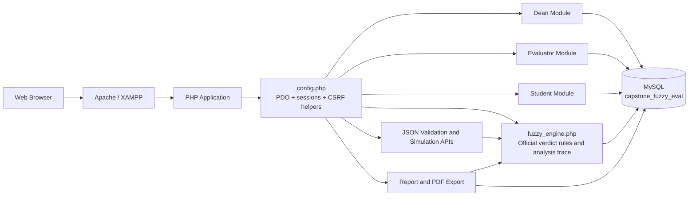
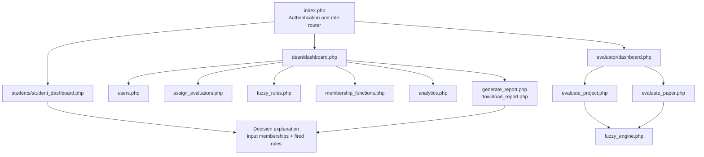
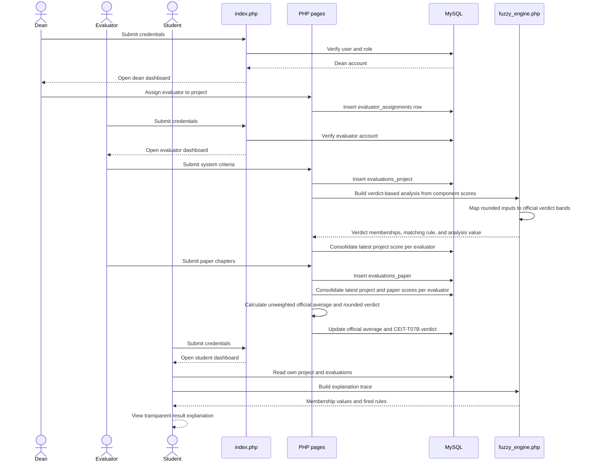
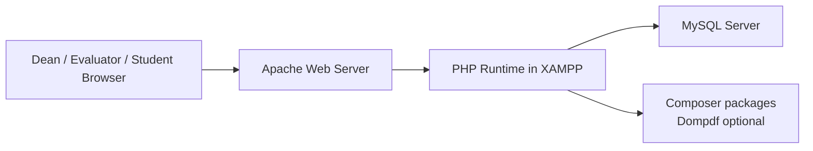

# BSIT Capstone Fuzzy Evaluation System Architecture

## 1. System Context

The BSIT Capstone Fuzzy Evaluation System is a PHP and MySQL web application for evaluating capstone projects through two controlled inputs: system/project quality and technical paper quality. A dean manages projects, users, and evaluators and can inspect the fixed fuzzy rules and membership functions. Evaluators score assigned projects. Students view their project status, scores, feedback, and the fuzzy decision trace.

The application is deployed as a server-rendered PHP site under XAMPP. Apache serves the pages, PHP executes business logic, and MySQL stores users, projects, evaluations, assignments, feedback, and history. The runtime fuzzy configuration is source-controlled in `php/fuzzy_engine.php`; legacy fuzzy configuration tables are not used.

## 2. High-Level Component Diagram



## 3. Role-Based Module Architecture



## 4. End-to-End Sequence



## 5. Data Architecture

```mermaid
erDiagram
    USERS ||--o{ PROJECTS : owns
    USERS ||--o{ EVALUATOR_ASSIGNMENTS : evaluates
    PROJECTS ||--o{ EVALUATOR_ASSIGNMENTS : receives
    PROJECTS ||--o{ EVALUATIONS_PROJECT : has
    PROJECTS ||--o{ EVALUATIONS_PAPER : has
    PROJECTS ||--o{ EVALUATION_FEEDBACK : receives
    PROJECTS ||--o{ EVALUATION_HISTORY : records
    USERS ||--o{ EVALUATION_FEEDBACK : writes
    USERS ||--o{ EVALUATION_HISTORY : creates

    USERS {
        int id PK
        string full_name
        string email
        string role
        string school_id
        string department
    }
    PROJECTS {
        int id PK
        string code
        string title
        int student_id FK
        decimal project_score
        decimal paper_score
        decimal overall_score
        string overall_rating
        string status
    }
    EVALUATOR_ASSIGNMENTS {
        int id PK
        int project_id FK
        int evaluator_id FK
        int assigned_by FK
        string status
    }
    EVALUATIONS_PROJECT {
        int id PK
        int project_id FK
        int evaluator_id FK
        decimal total_score
        text remarks
    }
    EVALUATIONS_PAPER {
        int id PK
        int project_id FK
        int evaluator_id FK
        decimal total_score
        text remarks
    }
    MEMBERSHIP_FUNCTIONS {
        int id PK
        string variable
        string label
        decimal a
        decimal b
        decimal c
        decimal d
    }
    FUZZY_RULES {
        int id PK
        text rule_text
        string status
    }
}
```

## 6. Main Processing Pipeline

1. `index.php` authenticates the user and redirects by role.
2. `config.php` creates the PDO connection, provides escaping and CSRF helpers, and loads the fuzzy engine.
3. The dean registers projects and assigns evaluators through `dean/assign_evaluators.php`.
4. `evaluator/evaluate_project.php` collects ten 0-10 system criteria and normalizes their sum to a 0-100 project score.
5. `evaluator/evaluate_paper.php` collects five 0-20 chapter scores and normalizes their sum to a 0-100 paper score.
6. `fuzzy_engine.php` loads verdict bands and generates the 25 verdict-combination rules from source code.
7. The engine maps each input to one verdict category, applies minimum rule firing and maximum consequent aggregation, and calculates the representative-score output.
8. The project record stores `project_score`, `paper_score`, `overall_score`, and `overall_rating`.
9. The shared CEIT-T07B verdict function classifies the rounded official panel-average score; the separate crisp rule-analysis output is only for explanation.
10. The dean report page presents the same result for printing or PDF generation.

## 7. Security and Control Boundaries

- Role checks are performed on dean, evaluator, and student pages.
- Database queries use PDO prepared statements for user-supplied identifiers and form values.
- POST forms use CSRF tokens through `csrf_token()` and `csrf_check()`.
- Output is escaped through `esc()` before being rendered in HTML.
- Evaluator visibility is restricted by the evaluator assignment workflow and dashboard query.
- Dean configuration pages and validation endpoints are read-only or disabled; fixed fuzzy rules and membership functions cannot be changed through the application.

## 8. Deployment View



## 9. Current Scope and Technical Note

The implementation is a prototype suitable for a capstone demonstration and controlled institutional evaluation workflow. Verdict analysis uses crisp one-hot membership, minimum rule firing, maximum consequent aggregation, and representative-score averaging. Because the membership bands do not overlap, this is not gradual fuzzy inference and should be described accurately in the thesis. The official result always comes from the panel-average score and CEIT-T07B classifier.
