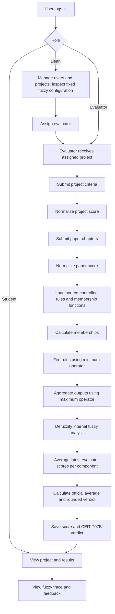

# System Documentation

## Title

**CEIT-T07B Verdict-Based Scoring System for BSIT Capstone Project Evaluation**

## Abstract

The CEIT-T07B Verdict-Based Scoring System is a role-based web application designed to improve the consistency, transparency, and efficiency of BSIT capstone project evaluation. It consolidates panel scores for project and paper quality, calculates an official average score and verdict, and separately runs fixed verdict-based rules to explain the analysis.

The application is implemented in PHP with MySQL as the persistence layer and is designed for deployment using Apache and XAMPP. It includes dean, evaluator, and student modules, evaluator assignment, project and paper evaluation forms, fuzzy simulation APIs, feedback support, report generation, and evaluation trace display.

## 1. Background and Rationale

Traditional capstone evaluation often depends on manual computation and direct numerical averaging. This can make results difficult to reproduce. The system applies the official CEIT-T07B score bands consistently and exposes a separate, crisp verdict-based rule analysis.

The system does not remove the evaluator's academic judgment. Instead, it standardizes the collection of evidence and applies a documented transformation from evaluator inputs to a final result.

## 2. Problem Statement

The system addresses the following problems:

1. Evaluation results may be difficult to reproduce when computations are manual.
2. Project quality and paper quality may be evaluated separately without a clear combined interpretation.
3. Students may receive a final score without seeing why that score was produced.
4. Evaluators may need access control so that they only work on assigned projects.
5. Fuzzy rules and membership functions need controlled updates so the inference process remains consistent across evaluations.

## 3. Objectives

### General Objective

To develop a web-based scoring system that provides consistent, transparent, and automated evaluation of BSIT capstone projects using the official CEIT-T07B verdict ranges.

### Specific Objectives

- Provide authenticated role-based access for dean, evaluator, and student users.
- Allow the dean to manage users, projects, and evaluators, and inspect the fixed membership functions and fuzzy rules.
- Allow the dean to assign evaluators to specific projects.
- Record system evaluation criteria and technical paper chapter scores.
- Normalize evaluator inputs into project and paper quality scores from 0 to 100.
- Apply predefined verdict-based rules to produce a separate analysis output.
- Calculate and classify the official CEIT-T07B score separately from the fuzzy output.
- Display verdict memberships, the matching rule, and the representative-score analysis output as an explanation.
- Provide report viewing, printing, and PDF export support.

## 4. Scope and Delimitations

### Scope

The system covers authentication, role routing, project records, evaluator assignment, system evaluation, paper evaluation, fuzzy processing, feedback display, student result viewing, analytics, and reporting.

### Delimitations

- The current deployment assumes PHP, MySQL, Apache, and XAMPP.
- The current engine uses source-controlled verdict bands and generated rules. Only a developer-approved source-code update can change this configuration.
- The current implementation stores the latest computed result on the project record.
- PDF export depends on Dompdf, wkhtmltopdf, or the browser-side fallback being available.
- The system is a prototype and should receive a security and operational hardening pass before production deployment.

## 5. Users and Responsibilities

| User | Responsibilities |
|---|---|
| Dean | Manage users, projects, evaluator assignments, analytics, and reports; inspect the fixed fuzzy rules and membership functions. |
| Evaluator | Evaluate assigned project criteria and paper chapters, then provide remarks. |
| Student | View project status, evaluation scores, fuzzy explanation, feedback, history, notifications, and profile data. |

## 6. Functional Requirements

| ID | Requirement |
|---|---|
| FR-01 | The system shall authenticate users and identify their role. |
| FR-02 | The system shall redirect each role to its appropriate dashboard. |
| FR-03 | The dean shall assign one or more evaluators to a project. |
| FR-04 | An evaluator shall submit ten system criteria scored from 0 to 10. |
| FR-05 | An evaluator shall submit five paper chapter scores scored from 0 to 20. |
| FR-06 | The system shall normalize project and paper inputs to a 0-100 scale. |
| FR-07 | The system shall use the fixed fuzzy rules and membership functions defined in the system source code. |
| FR-08 | The system shall calculate the official average and verdict from panel-average component scores, separately from fuzzy inference. |
| FR-09 | The student shall see the actual average, rounded classification score, official verdict, and internal fuzzy explanation trace. |
| FR-10 | The dean shall view and print or download a project report. |
| FR-11 | The system shall protect POST forms with CSRF validation. |
| FR-12 | The system shall escape rendered user-controlled values. |
| FR-13 | The dean shall not be able to create, edit, enable, disable, or delete fuzzy rules or membership functions. |
| FR-14 | The system shall classify the final 0–100 score using the five official CEIT-T07B verdict ranges. |

## 7. Non-Functional Requirements

- **Usability:** Forms and dashboards are separated by user role and expose the actions expected for that role.
- **Transparency:** The result page exposes input memberships, fired rules, rule strengths, output label, and defuzzified score.
- **Maintainability:** The fuzzy configuration is centralized in source code and displayed read-only to administrators.
- **Security:** Role checks, prepared statements, output escaping, password hashing, and CSRF checks are used in the application flow.
- **Availability:** The application is intended for local or institutional deployment through XAMPP.
- **Performance:** The current data volume is suitable for ordinary capstone evaluation workloads; indexing and pagination should be added for large deployments.

## 8. Fuzzy Processing Method

### 8.1 Panel averages and official average

The system stores each evaluator's latest score for each component, then calculates the panel average for each component:

- `ProjectQuality`: the system/project evaluation score from 0 to 100.
- `PaperQuality`: the technical paper score from 0 to 100.

The current application calculates its official final score as the unweighted arithmetic mean of the two component panel averages:

$$
FinalScore = \frac{ProjectQuality + PaperQuality}{2}
$$

No 60/40 weighting is applied. CEIT-T07B is described as using a final calculated average but does not specify weights for this application's separate project and paper components; equal component weighting is therefore an explicit implementation assumption that requires institutional confirmation.

### 8.2 Membership functions

Project Quality, Paper Quality, and Overall use only the five official CEIT-T07B verdict categories. Membership is crisp: the score is rounded half-up to a whole number and receives degree 1 in the matching verdict band and 0 in every other band. The five bands do not overlap:

| Official verdict | Rounded score band | Representative score |
|---|---:|---:|
| PASSED/APPROVED (No Revision) | 95–100 | 97.5 |
| PASSED/APPROVED (Minor Revision) | 80–94 | 87 |
| PASSED/APPROVED (Major Revision) | 60–79 | 69.5 |
| REDEFENSE | 50–59 | 54.5 |
| FAILED | 0–49 | 24.5 |

The representative scores are implementation-defined band midpoints used only to choose rule consequents and calculate the internal analysis output. The membership ranges and representative scores are defined in `php/fuzzy_engine.php`; the Dean page displays them. Legacy `membership_functions` database records are not used by the engine. Since membership is one-hot, this configuration has no gradual overlap and should not be described as trapezoidal membership.

### 8.3 Rule evaluation

A rule has the form:

`IF ProjectQuality IS PASSED/APPROVED (Minor Revision) AND PaperQuality IS REDEFENSE THEN Overall IS PASSED/APPROVED (Major Revision)`

There are 25 fixed rules: one for each combination of the five Project Quality and five Paper Quality verdict categories. Each consequent is generated by averaging the two antecedent categories' representative scores, then classifying that average using the official verdict bands. Rule strength uses the minimum membership degree:

$$
Strength(rule) = min(\mu_1, \mu_2, ..., \mu_n)
$$

Because each input belongs to exactly one category, exactly one of the 25 rules fires for a valid input pair, with strength 1. These are implementation-defined rules, not rules specified by CEIT-T07B. The Dean can inspect the generated rules but cannot create, edit, disable, or delete them. Legacy `fuzzy_rules` database records are not used by the engine.

### 8.4 Consequent aggregation

The engine retains the strongest rule strength for each output category:

$$
Strength(output) = max(Strength(rule_1), Strength(rule_2), ...)
$$

### 8.5 Defuzzification

Each output category is represented by its representative score. The internal analysis output is the weighted average of the active representative scores:

$$
DefuzzifiedScore = \frac{\sum center_i \times strength_i}{\sum strength_i}
$$

The complete rules produce an output for every valid input pair. With the current crisp memberships, one rule fires at strength 1, so the internal output equals that rule's representative score. This derived analysis output is retained in the trace; it does not replace or determine the official average score.

### 8.6 Official CEIT-T07B verdict

The official average score is retained to two decimal places, rounded to the nearest whole number using half-up rounding, then classified using the shared `official_verdict_from_score()` function:

| Rounded score | Verdict |
|---|---|
| 95–100 | PASSED/APPROVED (No Revision) — Outstanding Proposal. The group may proceed to Chapter 4 / Prototype Development and the remaining documentary requirements. |
| 80–94 | PASSED/APPROVED (Minor Revision) — Successful Proposal. The group must comply with the cited minor revisions before proceeding to development. |
| 60–79 | PASSED/APPROVED (Major Revision) — Core Methodological Adjustment. Significant corrections are required, and the adviser must approve the revisions before actual development begins. |
| 50–59 | REDEFENSE — Subject for Special Schedule of Presentation. The group is subject to a special presentation schedule. |
| 0–49 | FAILED — Subject for Course Re-enrollment, as specified in CEIT-T07B. |

The actual average and rounded classification score are both displayed. The internal rule-based analysis uses the same five verdict labels, while the authoritative official verdict is always classified directly from the panel-average final score. `fuzzy_rating_label()` and `fuzzy_rating_description()` remain compatibility wrappers around the shared official classification function.

## 9. Plain-Language Explanation of the Verdict Rules

A rule connects the project's verdict band and the paper's verdict band to an internal overall verdict category.

Example:

> If the project quality is PASSED/APPROVED (Minor Revision) and the paper quality is REDEFENSE, then the internal overall category is PASSED/APPROVED (Major Revision).

The word `IS` means the rounded component score belongs to that exact official verdict band. A score belongs to one category only; scores near a boundary do not partially belong to neighboring categories.

The word `AND` means both component verdicts must match the rule. The rule strength is the minimum of the two membership degrees. With one-hot membership, the matching rule fires at 1 and all other rules fire at 0.

The rule's representative score is used for the internal analysis trace. The official score and verdict are separately calculated from the panel averages described above.

This keeps the internal rules explainable, but crisp one-hot categories do not provide gradual fuzzy inference. The system shows the active input categories and matching rule alongside the separately calculated official average and verdict.

## 10. Process Flow

## 11. Database Summary

The primary records are defined in [sql/fuzzy_eval.sql](../sql/fuzzy_eval.sql):

- `users`: authenticated accounts and roles
- `projects`: capstone project details and current result
- `evaluator_assignments`: project-to-evaluator access control
- `evaluations_project`: ten project quality criteria
- `evaluations_paper`: five chapter scores
- Fuzzy categories and rules: fixed in `php/fuzzy_engine.php`; legacy `membership_functions` and `fuzzy_rules` tables are retained for database compatibility but are not read or changed by the application.
- `evaluation_feedback`: evaluator comments and recommendations
- `evaluation_history`: historical evaluation snapshots

## 12. Testing and Validation

The repository includes [tests/FuzzyEngineTest.php](../tests/FuzzyEngineTest.php), which checks verdict membership boundaries and generated verdict rules. Composer defines PHPUnit as a development dependency.

Recommended validation sequence:

1. Run `composer install`.
2. Run `./vendor/bin/phpunit --bootstrap vendor/autoload.php tests` from a Unix-like shell, or the equivalent Windows vendor command.
3. Run PHP syntax checks using the XAMPP PHP executable, for example `C:\xampp\php\php.exe -l fuzzy_engine.php`.
4. Import the SQL schema into MySQL.
5. Test dean assignment, evaluator scoring, student result viewing, and report generation through the browser.

## 13. Limitations and Future Improvements

- Add foreign-key constraints and indexes to the SQL schema.
- Enforce evaluator assignment checks directly in both evaluation pages, not only in the dashboard listing.
- Add server-side range validation for every score field.
- Record evaluation history and feedback during each save operation consistently.
- Add pagination and aggregate-query optimization for larger datasets.
- If gradual fuzzy inference is required by the research methodology, first define and approve overlapping membership functions; CEIT-T07B specifies verdict bands but does not define fuzzy membership parameters.
- Add audit logs, password reset, account lockout, and production session-cookie settings.

## 14. Conclusion

The system provides a complete evaluation workflow from project assignment to transparent fuzzy scoring and student reporting. Its main contribution is the combination of structured rubric inputs, fixed fuzzy logic, CEIT-T07B verdict classification, role-based access, and an explanation trace that allows users to inspect how the result was produced.
